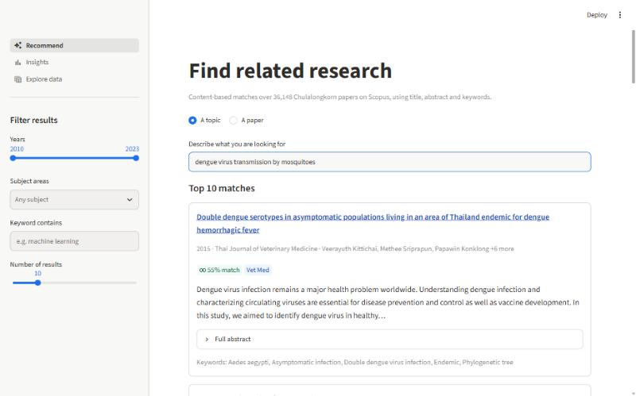
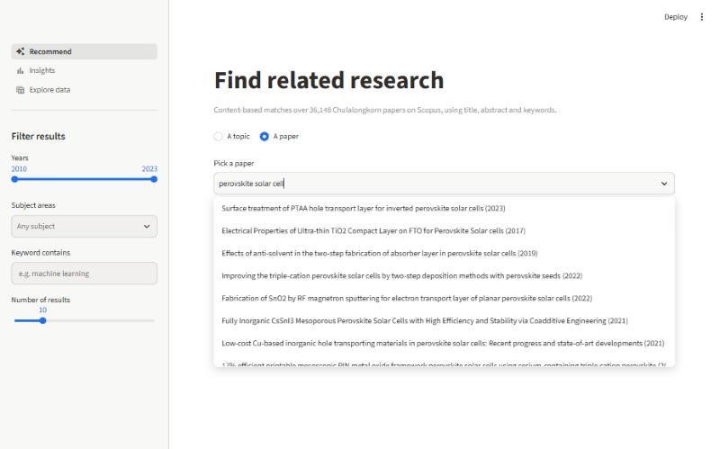
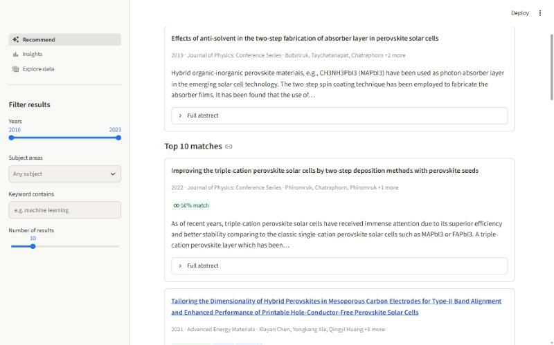
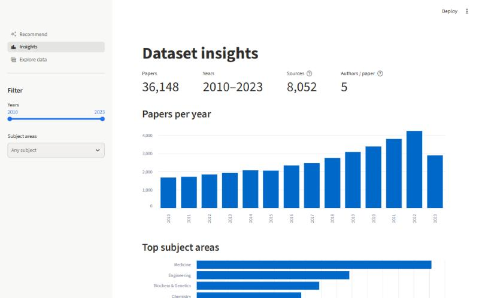
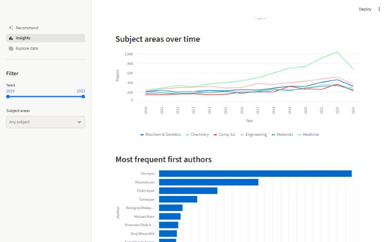
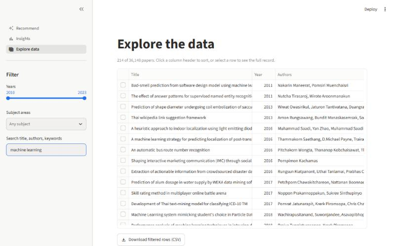
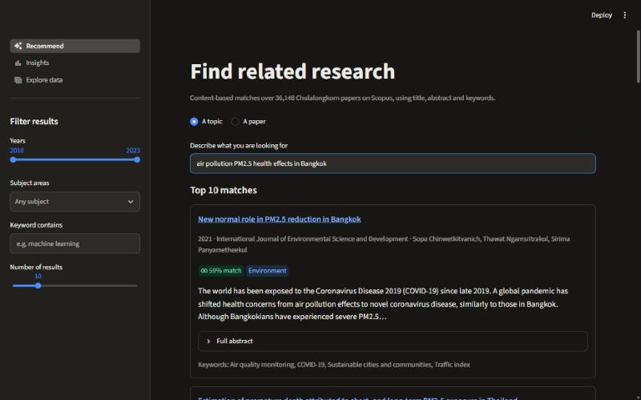

# Research Paper Recommender & Analytics Dashboard

[](https://github.com/kookithub/Research-Paper-Recommender-Analytics-Dashboard/actions/workflows/ci.yml)

Streamlit app that recommends related research papers by content similarity (TF-IDF over
title + abstract + keywords), over 36k Chulalongkorn University papers indexed in Scopus (2010-2023).

Pages:
- **Recommend**: describe a topic in your own words, or pick a paper, and get the closest matches.
  Filter by year range, subject area and keyword; choose how many results.
- **Insights**: papers per year, top subject areas, sources and first authors, subject trends over time.
- **Explore data**: searchable, sortable table with a full-record view and CSV export of the filtered rows.



## Screenshots

| Pick a paper: search 36k titles as you type | Papers similar to the one you picked |
| --- | --- |
|  |  |
| **Insights: dataset metrics and papers per year** | **Insights: subject areas over time** |
|  |  |
| **Explore: search, sort, export** | **Follows the system's dark mode** |
|  |  |

## How it works
Each paper's title, abstract and keywords become a TF-IDF vector (English stop words removed, terms
that appear in fewer than 2 papers dropped). The vectors are stored as a sparse matrix of 36,148 papers
by 57,769 terms. A paper uses about 85 distinct terms, so 99.85% of the matrix is zero and it takes
about 38 MB on disk.

A query is either an existing paper's row or free text turned into a vector the same way. Its cosine
similarity to every paper is one sparse matrix-vector product, which takes milliseconds. Filters are
applied before ranking, then the top N are shown. This gives the same scores as precomputing the full
36k x 36k similarity matrix (`tests/test_core.py` checks this), without the ~10.5 GB that matrix needs.

## Run the app
You need Python 3.11+, Git and about 1 GB of free disk space.

**0. Get the code**
```bash
git clone https://github.com/kookithub/Research-Paper-Recommender-Analytics-Dashboard.git
cd Research-Paper-Recommender-Analytics-Dashboard
```
Run every command below from this folder.

**1. Create an environment and install dependencies** (one time)

Windows (PowerShell):
```powershell
python -m venv .venv
.venv\Scripts\python -m pip install -r requirements.txt
```
macOS / Linux:
```bash
python3 -m venv .venv
.venv/bin/python -m pip install -r requirements.txt
```
With [uv](https://docs.astral.sh/uv/) installed, `uv venv .venv` then `uv pip install --python .venv -r requirements.txt` does the same, faster.

**2. Download the dataset** (one time, 86 MB into `data/processed/info.csv`)
```powershell
.venv\Scripts\python scripts\download_data.py      # macOS/Linux: .venv/bin/python scripts/download_data.py
```

**3. Start the app**
```powershell
.venv\Scripts\python -m streamlit run app\streamlit_app.py      # macOS/Linux: .venv/bin/python -m streamlit run app/streamlit_app.py
```
The app opens at **http://localhost:8501**. The first start takes about 20 seconds while it builds the
similarity model, which is then cached in `models/` and reused. Stop the app with `Ctrl+C` in the terminal.

## Tests and lint
```
uv pip install --python .venv -r requirements-dev.txt
.venv\Scripts\python -m pytest
.venv\Scripts\python -m ruff check
```
GitHub Actions runs the same checks on every push (`.github/workflows/ci.yml`). Tests use a small
inline fixture, so they don't need the dataset.

## Layout
```
app/
  streamlit_app.py     entry point, page navigation
  core/data.py         load + clean info.csv, shared filters
  core/model.py        TF-IDF model, similarity scoring
  views/               one module per page + shared UI components
tests/                 unit tests for parsing, filtering and ranking
docs/                  screenshots used in this README
scripts/
  download_data.py     fetch dataset files from the project Google Drive
  build_dataset.py     rebuild a 2018-2023 CSV from the raw Scopus JSON zip
notebooks/             original Colab notebooks (extraction, subject-code scrape, Scopus API fetch)
archive/app_original.py  the single-file app as it was on Drive
.streamlit/config.toml   light/dark theme, localhost-only server
data/                  (gitignored) raw/ and processed/ files
models/                (gitignored) cached TF-IDF model
```

## Data
The records come from [Scopus](https://www.scopus.com), Elsevier's abstract and citation database,
via its API: one record per paper with a Chulalongkorn University affiliation, published 2010-2023.

- `data/processed/info.csv` (86 MB, 36,163 rows): the prebuilt dataset from the original project
  Drive. This is what the app uses. The Scopus API key no longer works, so the 2010-2017 raw
  records can't be fetched again; this file is the only full copy.
- `data/raw/ScopusData2018-2023.zip` (502 MB, optional, `download_data.py --raw`): raw Scopus
  abstract-retrieval JSON, 2018-2023 only. `build_dataset.py` turns it into
  `data/processed/info_from_zip_2018-2023.csv` (20,141 rows).
- Subject areas are Scopus ASJC codes, grouped to their 2-digit parent (27 areas).

## Improvements over the original prototype
- Split the single `app.py` into data, model and page modules; added topic search, live results
  (no button), year/subject/keyword filters that are applied before ranking (the old version filtered
  only the top 50, so results often came back empty), match scores, native interactive charts,
  table search and CSV export.
- Similarity is computed per query from a sparse TF-IDF matrix. The old version precomputed the
  full 36k x 36k cosine matrix (~1.3 billion cells, ~10.5 GB).
- `info.csv` columns `Publication Name` / `Author_Count` are mapped to what the app reads, so source
  and author count now show (they were silently blank before).
- Fixed a crash on rerun (`st.toast` inside a cached function).
- `notebooks/API.ipynb`: hard-coded Elsevier key removed; reads `ELSEVIER_API_KEY` from the environment.

## Credits
This started as a team university project at Chulalongkorn University. In that team version I built
the recommendation (machine learning) part and the dashboard, mainly the machine learning; the team
built the data pipeline (Scopus API collection, JSON extraction, subject-code mapping). Those
originals are kept in `notebooks/` and `archive/`. The dataset was provided for the course. I later
rebuilt the app on my own: restructured code, the sparse recommendation engine, the UI, tests and CI.

## License
Code: [MIT](LICENSE). The Scopus records are not included in this repository; they belong to their
publishers and Elsevier and are subject to Scopus terms of use.
